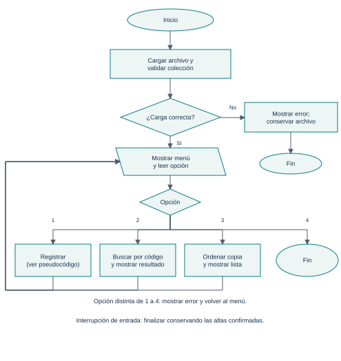
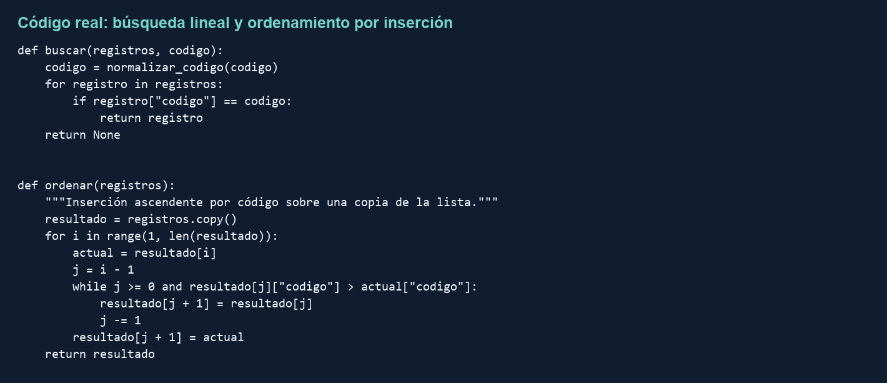
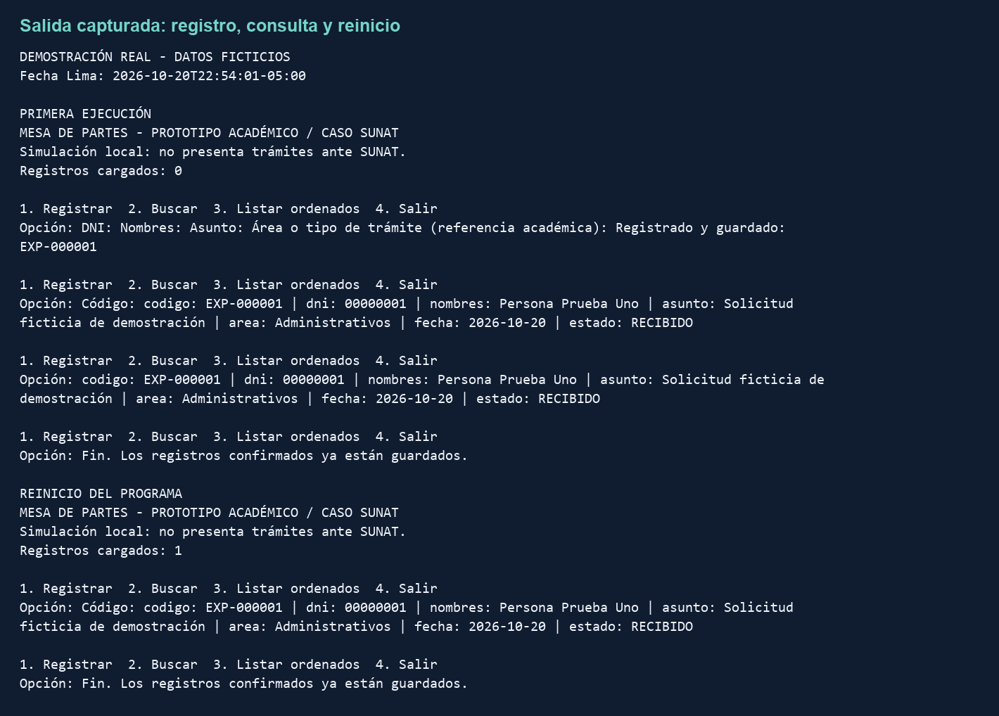
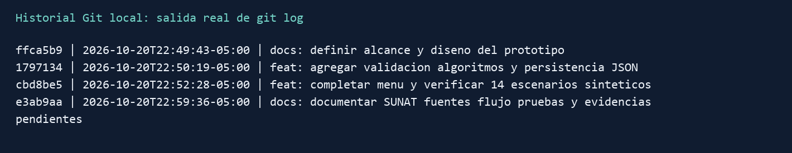
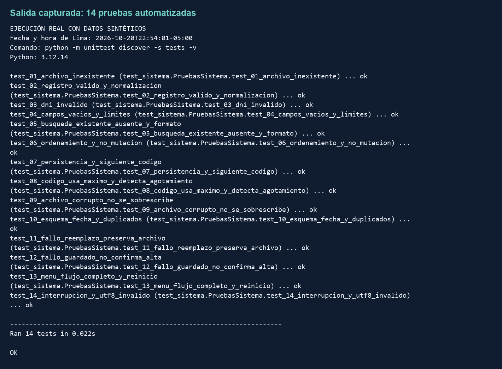

# Del archivador al algoritmo

PROTOTIPO DE MESA DE PARTES

Caso de referencia: SUNATFundamentos de Programación · CIIN1205PDesarrollo de los pasos 1 al 6 · 20 de octubre de 2026

Informe técnico y proyecto en Python

Se propone y desarrolla un sistema local para registrar, validar, consultar, ordenar y conservar expedientes. El estudio documental toma como referencia la mesa de partes de SUNAT; la implementación reproduce únicamente las operaciones básicas solicitadas por el curso.

| Dato de presentación | Completar por el equipo |
| --- | --- |
| Universidad / facultad / carrera | Pendiente |
| Grupo e integrantes (3 a 5) | Pendiente |
| Docente / ciclo / sección | Pendiente |
| Ciudad y año | Ciudad por completar · 2026 |
| Sede SUNAT / fecha de visita | Pendiente: no se aportaron evidencias de campo |

## Estado y alcance del trabajo

Desarrollado: análisis documental, requerimientos propuestos, comparación de alternativas, diagramación, pseudocódigo, programa funcional, historial Git y pruebas automatizadas con datos ficticios.

Pendiente de campo: visita documentada, fotografías fechadas, entrevista, mediciones de atención y pruebas con datos recogidos y anonimizados. Estas actividades no se presentan como realizadas.

Repositorio: github.com/ValentinoTR/PROYECTO

Documento elaborado con asistencia de IA. Debe ser revisado y comprendido por el equipo antes de su presentación. La declaración propuesta al final no reemplaza el formato oficial del aula virtual.

# Capítulo I. Planteamiento del problema

## 1.1 Descripción y delimitación del proceso

Se selecciona SUNAT por la relación entre la recepción de documentos y la necesidad de identificar, validar y recuperar expedientes. La entidad cuenta con una Mesa de Partes Virtual (MPV), que permite presentar documentos sin acudir físicamente a una oficina [S1]. No se afirma que SUNAT utilice un registro exclusivamente manual ni que existan deficiencias comprobadas en su sistema.

El caso municipal de la consigna se adapta a SUNAT como referencia académica. Esta elección debe validarse con el docente si exige observar un proceso manual presencial. El objeto del prototipo es el registro básico de expedientes; no sustituye el servicio oficial.

## 1.1.1 Proceso documentado en fuentes oficiales

Según el manual de SUNAT, el usuario accede a la MPV, selecciona el trámite y consigna el asunto y los datos solicitados. Puede adjuntar documentación y pasa por validaciones y autenticación según su identificación. La plataforma asigna un número de expediente. La admisión al sistema de gestión documental da lugar a una comunicación y un cargo de recepción [S2].

| Etapa documental | Representación en el prototipo |
| --- | --- |
| Identificación y datos de la solicitud | Ingreso de DNI, nombres, asunto y área de referencia. |
| Validación y autenticación | Solo comprobación de formato y campos; no autenticación oficial. |
| Registro del expediente | Generación de código académico EXP-000001 y fecha de Lima. |
| Comunicación y cargo | Confirmación local en consola; no emite un cargo oficial. |
| Consulta posterior | Búsqueda local por código y listado ordenado. |

## 1.2 Evidencia disponible y límites

La evidencia disponible es documental: páginas oficiales y manual de usuario consultados el 20/10/2026. No hay notas de visita, fotografías ni tiempos medidos. El anexo contiene una ficha lista para completar con observaciones reales. No deben usarse imágenes de internet como si fueran fotografías tomadas por el equipo.

Los problemas de transcripción, duplicidad, búsqueda lenta y pérdida de hojas son riesgos hipotéticos del escenario manual planteado por el curso. Su frecuencia en una sede de SUNAT no ha sido medida.

# Capítulo I. Problema y objetivos

## 1.3 Identificación del problema

Problema de diseño: ¿cómo registrar y recuperar expedientes de forma consistente mediante un programa sencillo que valide datos, evite códigos duplicados y conserve la información entre ejecuciones? Esta pregunta corresponde al prototipo académico. No se ha diagnosticado una falla operativa en SUNAT, pues no se cuenta con evidencia de campo.

## 1.4 Entradas, procesos y salidas

| Entradas | Procesos | Salidas |
| --- | --- | --- |
| DNI, nombres, asunto y área de referencia. | Limpiar espacios, comprobar longitudes y formato del DNI. | Datos aceptados o mensaje de error. |
| Lista existente y solicitud válida. | Asignar código correlativo único y fecha; guardar JSON. | Expediente confirmado con estado RECIBIDO. |
| Código de expediente. | Normalizar el código y recorrer los registros. | Registro encontrado o aviso de ausencia. |
| Colección de expedientes. | Ordenar una copia por inserción. | Listado ascendente por código. |
| Archivo JSON al iniciar. | Leer y validar estructura, códigos, fechas y campos. | Colección recuperada o bloqueo ante archivo inválido. |

## 1.5 Justificación

El proyecto permite al equipo transformar una secuencia de recepción documental en operaciones verificables. Los beneficiarios directos son los estudiantes y usuarios de la demostración; se espera facilitar el registro y la recuperación local de información. Una posible utilidad institucional requeriría validación con el personal, mediciones y controles adicionales.

## 1.6 Objetivos

Objetivo general: desarrollar una solución algorítmica en Python para registrar, validar, consultar, ordenar y almacenar expedientes de un caso académico inspirado en SUNAT.

Objetivos específicos: identificar campos y restricciones; diseñar el flujo y pseudocódigo; implementar funciones y estructuras de datos; conservar registros en un archivo; verificar resultados mediante pruebas reproducibles y documentar las limitaciones.

# Capítulo II. Requerimientos

Los requerimientos se derivan de la consigna y del alcance académico. La entrevista con el responsable del área está pendiente; por ello no se atribuyen estas decisiones a personal de SUNAT.

## 2.1 Requerimientos funcionales y aceptación

| ID | Requerimiento y criterio verificable |
| --- | --- |
| RF01 | Registrar un expediente válido con código único; confirmar solo después de guardar. |
| RF02 | Rechazar DNI distinto de ocho dígitos ASCII y textos vacíos o fuera de los límites. |
| RF03 | Buscar por código sin distinguir mayúsculas y mostrar ausencia si no existe. |
| RF04 | Listar por código ascendente sin alterar la colección original. |
| RF05 | Recuperar al reiniciar los expedientes previamente guardados. |
| RF06 | Si el archivo está corrupto o tiene duplicados, no cargarlo ni sobrescribirlo. |
| RF07 | Controlar opciones inválidas e interrupciones sin perder altas confirmadas. |

## 2.1.1 Requerimientos no funcionales

Ejecutarse con Python 3.10 o superior y biblioteca estándar; separar interfaz, reglas y archivos; conservar tildes con UTF-8; mostrar errores comprensibles. Se asume un operador y una sola instancia del programa. Los ensayos usan datos ficticios para no divulgar información personal.

# Capítulo II. Alternativas de solución

## 2.2 Propuesta y 2.3 matriz comparativa

Se comparan dos diseños algorítmicos propios y la contratación de un proveedor. La comparación corresponde al ejercicio académico; no constituye una evaluación del sistema actual ni de las compras de SUNAT.

| Criterio | A. Lista + búsqueda lineal | B. Lista ordenada + búsqueda binaria | C. Tercerización |
| --- | --- | --- | --- |
| Registro | Agregar a lista; código desde máximo existente. | Insertar manteniendo orden; desplazar elementos. | Según diseño contratado. |
| Búsqueda | Recorrer hasta encontrar. O(n). | Dividir intervalo ordenado. O(log n). | Exigir pruebas y medir. |
| Ordenamiento | Inserción al listar. O(n²) peor caso. | Se conserva al insertar; inserción O(n). | Depende del proveedor. |
| Persistencia | Archivo JSON completo, O(n). | Archivo JSON completo, O(n). | Formato y exportación a pactar. |
| Recursos | Python, equipo local y tiempo de desarrollo. | Mismos recursos; mayor cuidado del orden. | Presupuesto, contrato y seguimiento. |
| Tiempo relativo | Menor complejidad inicial; planificar pruebas. | Mayor esfuerzo para mantener el orden. | Plazo y entregables sujetos a cotización. |
| Ventaja | Código sencillo de explicar y probar. | Consultas más eficientes en colecciones grandes. | Soporte sujeto al contrato. |
| Limitación | Escala limitada y uso monousuario. | Más invariantes; guardar sigue siendo O(n). | Dependencia, costo y acceso al código. |
| Viabilidad académica | Alta para demostrar fundamentos. | Media: viable con mayor complejidad. | Baja para demostrar desarrollo propio. |

# Capítulo II. Selección de la solución

## 2.3.1 Selección y justificación

Se elige A por su claridad, facilidad de mantenimiento y correspondencia con funciones, arreglos/listas, cadenas, ciclos y archivos. Para un conjunto pequeño de demostración, la búsqueda lineal y la inserción permiten explicar cada paso. Esta decisión no supone que A sea apropiada para el volumen real de SUNAT, que no se conoce.

## 2.3.2 Referencia de costos y recursos

No se dispone de una cotización verificable. Como escenario ilustrativo, no precio de mercado, 40 horas a S/ 50 por hora equivalen a S/ 2 000 de desarrollo, antes de soporte, alojamiento o impuestos. La decisión real exige cotizaciones y un alcance equivalente. El desarrollo propio tampoco es gratuito: consume tiempo del equipo y mantenimiento.

Regla de comparación: costo total = desarrollo + puesta en marcha + soporte + infraestructura. La tarifa y las horas anteriores son supuestos pedagógicos, no datos de SUNAT.

## 2.4 Principios de matemáticas e ingeniería

Lógica: condiciones compuestas para aceptar datos. Secuencia y repetición: menú y recorrido de registros. Matemática: máximo más uno para el correlativo; comparación de códigos con seis dígitos fijos. Ingeniería: separación de responsabilidades, validación antes de persistir y pruebas de comportamientos observables.

Invariantes: códigos únicos; datos válidos; confirmación posterior al guardado; ordenamiento sin mutar la lista original. El reemplazo temporal reduce el riesgo de escritura parcial, pero no cubre fallos de hardware ni concurrencia.

# Capítulo III. Diseño del algoritmo

## 3.1 Descripción de la solución

El operador abre el programa y carga los expedientes. Desde el menú puede registrar, buscar o listar. Cada alta válida recibe un código y se guarda antes de confirmarse. La consulta recupera un registro por código y el listado muestra una copia ordenada. Al salir y volver a iniciar, el archivo permite recuperar lo registrado.

## 3.2 Diseño de entradas, procesos y salidas

Se emplea una lista de diccionarios: cada posición representa un expediente y cada clave, un campo. El DNI se guarda como texto para conservar ceros iniciales. JSON conserva la estructura en un archivo legible [S4].

| Campo | Tipo / regla del prototipo |
| --- | --- |
| codigo | Cadena EXP-000001 a EXP-999999; único. Se calcula máximo + 1. |
| dni | Cadena de 8 dígitos ASCII. Valida formato, no identidad ni vigencia. |
| nombres | Texto limpio de 2 a 100 caracteres. |
| asunto | Texto limpio de 5 a 200 caracteres. Límite académico propio. |
| area | Texto limpio de 2 a 80 caracteres; referencia, no derivación real. |
| fecha | AAAA-MM-DD; fecha automática de Lima al registrar. |
| estado | Valor fijo RECIBIDO; no significa admisión oficial de SUNAT. |

## 3.5 Diseño modular

| Módulo | Funciones y responsabilidad |
| --- | --- |
| main.py | ejecutar: menú; registrar: alta y confirmación; mostrar: salida. |
| dominio.py | validar_datos y texto: reglas; validar_coleccion: integridad; siguiente_codigo y crear_expediente: alta; buscar: recorrido lineal; ordenar: inserción. |
| almacenamiento.py | cargar: lectura y validación; guardar: escritura temporal y reemplazo. |
| tests/test_sistema.py | Casos de prueba automatizados con directorios temporales. |

# 3.4 Diagrama de flujo general



## Lectura del flujo

Cada operación vuelve al menú. En el registro, la secuencia es: leer campos, validar, generar expediente, guardar la colección candidata y confirmar. Un dato inválido o error de escritura cancela el alta y devuelve el control al menú con un mensaje. La ausencia del archivo inicia una colección vacía; un archivo existente inválido detiene el inicio.

# 3.3 Pseudocódigo: control y registro

```text
PROCEDIMIENTO PRINCIPAL(ruta)
  INTENTAR
    registros <- CARGAR(ruta)
  SI FALLA
    MOSTRAR error; TERMINAR sin cambiar archivo
  FIN INTENTAR
  REPETIR
    MOSTRAR menú; LEER opcion
    INTENTAR
      SEGÚN opcion
        1: REGISTRAR(registros, ruta)
        2: LEER codigo
           resultado <- BUSCAR(registros, codigo)
           MOSTRAR resultado o "No encontrado"
        3: MOSTRAR ORDENAR(registros) o "Sin registros"
        4: TERMINAR
        OTRO: MOSTRAR "Opción inválida"
      FIN SEGÚN
    SI FALLA validación o archivo
      MOSTRAR error; VOLVER al menú
    FIN INTENTAR
  HASTA salir
  SI entrada interrumpida: TERMINAR
FIN PROCEDIMIENTO

PROCEDIMIENTO REGISTRAR(registros, ruta)
  LEER dni, nombres, asunto, area
  datos <- VALIDAR_DATOS(dni, nombres, asunto, area)
  mayor <- máximo correlativo de registros, o 0
  SI mayor = 999999: INFORMAR error y CANCELAR
  codigo <- "EXP-" + (mayor + 1) con seis dígitos
  nuevo <- datos + codigo + fecha de Lima + "RECIBIDO"
  candidatos <- copia de registros con nuevo al final
  GUARDAR(ruta, candidatos)
  // Si GUARDAR falla, no se ejecutan las líneas siguientes.
  AGREGAR nuevo a registros
  MOSTRAR "Registrado y guardado" y codigo
FIN PROCEDIMIENTO
```

## Validación de entradas

VALIDAR_DATOS comprueba ocho dígitos del 0 al 9 en el DNI. Para cada texto, rechaza caracteres de control, elimina espacios exteriores y repetidos y verifica el rango de longitud indicado en 3.2. Si falla una regla, devuelve un error; el operador vuelve a elegir registrar para reingresar los datos.

# 3.3 Pseudocódigo: archivos y algoritmos

```text
FUNCIÓN CARGAR(ruta)
  SI archivo no existe: RETORNAR lista vacía
  contenido <- LEER archivo en UTF-8
  registros <- INTERPRETAR JSON(contenido)
  VALIDAR_COLECCIÓN(registros)
  RETORNAR registros
FIN FUNCIÓN

PROCEDIMIENTO GUARDAR(ruta, registros)
  VALIDAR_COLECCIÓN(registros)
  CREAR carpeta de datos si no existe
  CREAR archivo temporal en la misma carpeta
  INTENTAR
    ESCRIBIR registros como JSON UTF-8 en temporal
    VACIAR búfer, sincronizar y cerrar temporal
    REEMPLAZAR archivo destino con temporal
  FINALMENTE
    ELIMINAR temporal si todavía existe
  FIN INTENTAR
FIN PROCEDIMIENTO

FUNCIÓN BUSCAR(registros, codigo)
  codigo <- MAYÚSCULAS y QUITAR ESPACIOS(codigo)
  VALIDAR formato EXP-000001 a EXP-999999
  PARA CADA registro EN registros
    SI registro.codigo = codigo: RETORNAR registro
  FIN PARA
  RETORNAR nulo
FIN FUNCIÓN

FUNCIÓN ORDENAR(registros)
  copia <- COPIAR lista de registros
  PARA i DESDE 1 HASTA longitud(copia) - 1
    actual <- copia[i]; j <- i - 1
    MIENTRAS j >= 0 Y copia[j].codigo > actual.codigo
      copia[j + 1] <- copia[j]
      j <- j - 1
    FIN MIENTRAS
    copia[j + 1] <- actual
  FIN PARA
  RETORNAR copia
FIN FUNCIÓN
```

VALIDAR_COLECCIÓN exige una lista de registros con los siete campos definidos, códigos válidos y no duplicados, textos normalizados, fecha ISO válida y estado RECIBIDO. Cualquier incumplimiento genera error. El control de duplicidad usa un conjunto auxiliar.

# Capítulo IV. Implementación

## 4.1 Herramientas utilizadas

La edición y revisión se realizó mediante herramientas de asistencia de código de Codex, y el versionado con Git y GitHub. El programa se implementó en Python 3 y se ejecutó con Python 3.12.14. Utiliza condicionales, bucles, funciones con parámetros y retorno, listas, diccionarios, cadenas y archivos. Las dependencias pertenecen a la biblioteca estándar; las herramientas usadas para preparar este informe no son necesarias para ejecutar el programa.

```text
python main.py
python -m unittest discover -s tests -v
```

Desde Windows también puede usarse py main.py. El archivo de datos se crea en datos/expedientes.json. Para una demostración independiente puede elegirse otro destino con la opción --archivo.

## 4.2 Estructuras y 4.3 organización del código



Figura: renderización del código real de dominio.py, incluido completo en el proyecto. La imagen permite leer los algoritmos; no es una fotografía ni una captura del sistema de SUNAT.

# 4.4 Control de versiones y trazabilidad

Se guardaron avances reales durante esta sesión mediante Git. No se modificaron fechas para simular un desarrollo anterior. El repositorio remoto se publicó por etapas usando la conexión autorizada de GitHub; los identificadores locales y remotos difieren porque se crearon por mecanismos distintos.

| Ámbito | Avance verificable |
| --- | --- |
| Git local · ffca5b9 | Definición del alcance, instrucciones y diseño. |
| Git local · 1797134 | Validaciones, búsqueda, ordenamiento y persistencia JSON. |
| Git local · cbd8be5 | Menú, adaptación al caso SUNAT y pruebas automatizadas. |
| GitHub · ee043e6 | Inicio documental del proyecto y reconocimiento de asistencia de IA. |
| GitHub · 282ae94 | Publicación de interfaz, reglas del dominio y almacenamiento. |
| Revisiones posteriores | Pruebas, documentación y evidencias: consultar el historial completo del repositorio y los registros incluidos en el ZIP. |

## Comprobación del historial

En GitHub, abrir el historial de commits y revisar el contenido de cada cambio. El ZIP incluye historial.bundle para restaurar el desarrollo local y una copia de los archivos. La carpeta datos/ está excluida del versionado para evitar subir futuros expedientes personales.

```text
git log --oneline --date=iso
git clone historial.bundle mesa_partes_restaurada
```

## Relación con las estructuras del curso

| Concepto | Uso concreto |
| --- | --- |
| Estructuras de control | Menú repetitivo, decisiones de validación y recorrido de registros. |
| Arreglos y cadenas | Lista de expedientes; limpieza de espacios, formato y comparación de códigos. |
| Funciones y módulos | Separación de operaciones y reutilización de validaciones. |
| Persistencia | Lectura, validación y escritura de JSON UTF-8. |
| Control de versiones | Cambios identificables y recuperables, con autoría asistida declarada. |

# 4.5 Evidencias de ejecución



Figura: salida capturada de dos ejecuciones reales. La primera registra y consulta EXP-000001; la segunda recupera el mismo registro desde el archivo. La entrada se suministró automáticamente para reproducir la demostración. El contenido y el DNI son ficticios.

## Reproducción de la demostración

Ejecutar main.py, elegir 1 e ingresar datos de prueba; consultar el código con 2; listar con 3 y salir con 4. Volver a abrir el programa y buscar el mismo código. Los archivos evidencias/demo.txt y evidencias/datos_sinteticos.json permiten contrastar el resultado mostrado.

## Pruebas pendientes con información de campo

Después de la visita, convertir ejemplos autorizados en registros anonimizados, repetir los escenarios de alta, búsqueda y reinicio, y registrar resultado esperado, resultado observado y ajustes. No ingresar expedientes ficticios en la plataforma real de SUNAT para realizar esta práctica.

# Capítulo V. Pruebas y resultados

## 5.1 Plan de pruebas

Resultado: 14 pruebas automatizadas aprobadas. La ejecución final registrada en evidencias/pruebas.txt usa Python 3.12.14. Se añadieron dos ejecuciones de consola para comprobar registro y recuperación al reiniciar. Todos los datos son sintéticos; aún no se realizaron pruebas con datos recogidos en campo.

## 5.2 Casos de prueba ejecutados

| Caso | Entrada / condición | Esperado | Obtenido |
| --- | --- | --- | --- |
| 01 | Archivo inexistente. | Lista vacía. | Lista vacía; aprobado. |
| 02 | DNI 00000001 y espacios. | Conservar ceros; limpiar espacios. | DNI y nombre normalizados. |
| 03 | DNI corto, largo, con letras o no ASCII. | Rechazar los formatos inválidos. | ValueError en cada variante. |
| 04 | Texto vacío, muy largo o con controles. | Rechazar cada variante. | Validación rechazó los datos. |
| 05 | Código presente, ausente e inválido. | Registro, nulo o error según caso. | Tres respuestas correctas. |
| 06 | Códigos 10, 2, 1, 20. | Orden 1, 2, 10, 20; no mutar original. | Orden correcto; original intacto. |
| 07 | Guardar y volver a cargar. | Conservar tildes; siguiente código 2. | Datos conservados; EXP-000002. |
| 08 | Lista sin ordenar; máximo 999999. | Usar máximo; detectar agotamiento. | Correlativo correcto y error al límite. |
| 09 | JSON corrupto. | Bloquear inicio sin sobrescribir. | Salida 1; archivo sin cambios. |
| 10 | Esquema, fecha, duplicados o estado inválidos. | Rechazar colección inválida. | ValueError en cada variante. |
| 11 | Fallo simulado de reemplazo. | Preservar archivo; limpiar temporal. | Archivo idéntico; ningún temporal. |
| 12 | Fallo simulado al guardar alta. | No confirmar ni agregar a memoria. | Lista permaneció vacía. |
| 13 | Menú completo y reinicio. | Mensajes correctos y un registro persistido. | Flujo correcto; un registro al iniciar. |
| 14 | Fin de entrada; UTF-8 inválido. | Salida controlada; conservar archivo. | Códigos de salida 0 y 1; sin cambios. |

## 5.3 Análisis de resultados

Los 14 casos aprobaron en uso local y monousuario. Se verificaron la fecha de Lima y la confirmación posterior al guardado. No se atribuyen mejoras de tiempos de atención: faltan mediciones de campo.

# Capítulo VI. Aprendizaje y reflexión

## 6.4 Reflexión técnica y ética

El prototipo demuestra que una secuencia de recepción y consulta puede expresarse con reglas claras y funciones separadas. Validar antes de guardar evita incorporar registros mal formados, mientras que consultar después de reiniciar comprueba una propiedad que no se demuestra únicamente con un mensaje de éxito: la persistencia.

La elección de búsqueda lineal facilita la explicación, pero su costo crece con la cantidad de registros. El ordenamiento por inserción puede requerir muchas comparaciones para listas grandes. Si el proyecto evolucionara a varios operadores o gran volumen, correspondería reconsiderar la persistencia, los índices y el control de concurrencia.

## Responsabilidad sobre los datos

Los documentos de un trámite pueden contener información personal. Las demostraciones deben usar datos ficticios o anonimizados y evitar DNI, nombres, credenciales o documentos reales en GitHub. Una fotografía del área solo debe incorporarse con autorización y sin información identificable de terceros.

También es necesario distinguir fuentes oficiales, suposiciones y observaciones. El estudio documental no demuestra que se realizó una visita, ni permite atribuir problemas al personal de SUNAT. El código EXP y el estado RECIBIDO pertenecen al ejercicio y carecen de valor como cargo oficial.

## 6.1 Estrategias y 6.2 conocimientos incorporados

Se documenta la serialización JSON para conservar listas y diccionarios, incluyendo texto con tildes [S4]. Se incorpora una estrategia de guardado mediante archivo temporal, sincronización y reemplazo del destino, apoyada en las operaciones de archivos de Python [S5]. Las pruebas simulan una falla de reemplazo para verificar la conservación de la versión anterior.

La estrategia aplicada consiste en dividir el problema por responsabilidades, consultar documentación, construir ejemplos pequeños y verificar casos normales y de error. El equipo deberá contrastar estos contenidos con su sílabo antes de afirmar cuál de ellos es distinto a lo aprendido en clase.

## 6.3 Aspectos por mejorar

Completar primero la evidencia de campo y contrastar los requerimientos. Después, valorar autenticación, respaldos, auditoría, adjuntos y tipos de documento adicionales. El prototipo actual no integra Clave SOL, no envía correos, no calcula plazos de presentación y no certifica cumplimiento normativo.

# Capítulo VII. Conclusiones

## 7.1 Conclusiones vinculadas con los objetivos

1. Se definió un modelo de datos de siete campos que permite representar expedientes y expresar reglas verificables. La revisión de las fuentes de SUNAT sirvió para delimitar el caso; la comprobación presencial de necesidades permanece pendiente.

2. El diagrama y el pseudocódigo describen un flujo coherente con los módulos implementados: captura, validación, generación de código, almacenamiento, búsqueda y listado ordenado.

3. La solución en Python aplica estructuras de control, funciones, listas y cadenas. La persistencia en JSON permite recuperar el expediente después de reiniciar, como se comprobó mediante dos ejecuciones reales de consola.

4. Las 14 pruebas sintéticas verificaron comportamientos normales y de error, incluyendo conservación del archivo ante un fallo simulado de reemplazo. Estos resultados no equivalen a una validación con datos de campo ni a una prueba de carga institucional.

5. El proyecto incorpora manejo de archivos temporales y pruebas automatizadas como recursos de aprendizaje documentados. El equipo debe explicar estas decisiones y contrastar los conocimientos nuevos con lo trabajado en clase.

## 7.2 Recomendaciones

Completar la observación y entrevista; contrastar campos y restricciones; repetir pruebas con información anonimizada; medir tiempos sin atribuir beneficios antes de comprobarlos. Para ampliar la solución, estudiar bases de datos, autenticación, auditoría y control de concurrencia. Mantener el código revisado y una política de respaldos antes de usar información real.

## Relación entre los pasos y los capítulos

| Pasos de campo | Ubicación en el informe |
| --- | --- |
| 1 y 2 | Capítulo I: proceso y problema; capítulo II: requerimientos. |
| 3 | Capítulo II: alternativas, comparación y selección. |
| 4 | Capítulo III: diseño, flujo, pseudocódigo y módulos. |
| 5 | Capítulo IV: implementación, ejecución e historial. |
| 6 | Capítulos V, VI y VII: pruebas, reflexión y conclusiones. |

# 7.3 Referencias y estado de entrega

Fuentes oficiales consultadas el 20 de octubre de 2026. El proceso se resume con fines académicos; para un trámite real deben revisarse las instrucciones vigentes de SUNAT.

[S1] SUNAT. Centro de Servicios Virtual: Mesa de Partes virtual.https://centrovirtual.sunat.gob.pe/node/46

[S2] SUNAT. Manual de usuario de la Mesa de Partes Virtual, pp. 2-12.https://orientacion.sunat.gob.pe/sites/default/files/inline-files/manual_usuario_Mesa_partes.pdf

[S3] SUNAT. Orientación: Mesa de Partes Virtual.https://orientacion.sunat.gob.pe/mesa-de-partes-virtual

[S4] Python Software Foundation. json: codificador y decodificador JSON.https://docs.python.org/3/library/json.html

[S5] Python Software Foundation. os: operaciones de archivos, fsync y replace.https://docs.python.org/3/library/os.html

[S7] Guía complementaria proporcionada por el usuario: exps.pdf, Curso: Fundamentos de Programación, estructura de informe en siete capítulos y relación con la rúbrica.

[S6] Material del curso proporcionado por el usuario: expo.pdf, Evaluación final - Desafío del curso Fundamentos de Programación, sección II.B y consideraciones del entregable.

## Qué falta para acreditar completamente los seis pasos

| Paso | Estado de la evidencia |
| --- | --- |
| 1 | Descripción documental desarrollada. Visita, fotos fechadas y tiempos: pendientes. |
| 2 | Análisis y requerimientos propuestos. Entrevista y validación del responsable: pendientes. |
| 3 | Comparación y justificación desarrolladas. Costo externo ilustrativo; cotización real pendiente. |
| 4 | Diseño, diagrama, pseudocódigo y módulos desarrollados. |
| 5 | Programa funcional e historial local y remoto. Archivos y evidencias incluidos. |
| 6 | 14 pruebas sintéticas y reflexión desarrolladas. Pruebas con datos de campo: pendientes. |

No se incluyeron diapositivas porque la solicitud se limita a los pasos de la práctica de campo. El informe y el proyecto proporcionan la base para preparar posteriormente la sustentación.

# 7.4 Anexo A. Ficha para completar en SUNAT

Plantilla de recolección: no contiene datos de una visita realizada. Completar después de observar el proceso y conversar con un responsable que acepte participar.

| Dato | Registro del equipo |
| --- | --- |
| Sede / dirección | ____________________________________________ |
| Fecha / horario / observadores | ____________________________________________ |
| Área / cargo del entrevistado | ____________________________________________ |
| Autorización para fotografías | ____________________________________________ |

## Bitácora fotográfica y notas

| ID | Evidencia por recoger | Fecha / nota |
| --- | --- | --- |
| F01 | Acceso o señalización del área, con autorización. | Pendiente |
| F02 | Formato vacío o ejemplo anonimizado autorizado. | Pendiente |
| F03 | Secuencia de recepción o cargo anonimizado, con autorización. | Pendiente |

## Tiempos de atención (sin identificadores personales)

| Caso | Inicio de atención | Fin de atención | Duración |
| --- | --- | --- | --- |
| T01 | Pendiente | Pendiente | Pendiente |
| T02 | Pendiente | Pendiente | Pendiente |
| T03 | Pendiente | Pendiente | Pendiente |

Duración = hora de fin - hora de inicio. Promedio = suma de duraciones / número de casos. Registrar aparte el tiempo de espera; no confundirlo con el tiempo de atención. Unos pocos casos describen la muestra y no representan por sí solos a toda SUNAT.

## Preguntas para la entrevista

1. ¿Qué datos se solicitan al recibir un documento?2. ¿Qué revisiones se realizan antes de registrar el expediente?3. ¿Cómo se asigna el código y se entrega el cargo?4. ¿Cómo se consulta el estado y se deriva la documentación?5. ¿Qué dificultades frecuentes pueden describirse sin revelar datos personales?6. ¿Qué requisitos del prototipo habría que cambiar?

Registrar cada respuesta con fecha y cargo del informante, sin inventar citas ni nombres.

# 7.4 Anexo B. Revisión y declaración de IA

## Texto propuesto para adaptar al formato oficial

Este trabajo se elaboró con asistencia de inteligencia artificial para organizar el análisis documental, proponer requerimientos, diseñar el algoritmo, generar y revisar código Python y preparar pruebas con datos sintéticos. La evidencia de ejecución corresponde al programa entregado. No se generaron fotografías ni entrevistas ficticias como evidencia de campo.

Los integrantes deben revisar las fuentes, comprender y explicar el código, verificar los resultados y completar las actividades de campo pendientes. El formato oficial de declaración de uso de IA debe obtenerse del aula virtual y adjuntarse según la consigna.

## Revisión previa a la entrega

| Revisión | Acción del equipo |
| --- | --- |
| Identificación | Completar grupo, integrantes, docente y sección. |
| Caso SUNAT | Confirmar con el docente la adaptación desde el caso municipal. |
| Trabajo de campo | Incorporar fotografías fechadas, notas, tiempos y entrevista autorizada. |
| Análisis | Sustituir o confirmar supuestos con los hallazgos de campo. |
| Programa | Ejecutar el menú, revisar funciones y explicar cada algoritmo. |
| Pruebas reales | Repetir escenarios con información recogida y anonimizada. |
| Publicación | Comprobar que el repositorio no contenga información personal real. |
| IA | Adjuntar el formato oficial y describir el uso efectivamente realizado. |

## Conclusión del desarrollo

Se dispone de un prototipo académico ejecutable y verificable que cubre registro, validación, búsqueda, ordenamiento y almacenamiento. La prueba automatizada y la recuperación después del reinicio respaldan su funcionamiento en los escenarios incluidos. La validación del caso institucional seguirá incompleta hasta incorporar evidencia real de campo.

# 7.4 Anexo C. Evidencias complementarias



Renderización de la salida real de git log del historial local hasta la documentación inicial. Las revisiones posteriores se conservan en el bundle. Los horarios proceden de Git; no se alteraron para simular sesiones anteriores.



Salida completa de la ejecución de las 14 pruebas con datos sintéticos. La versión de texto permite revisar nombres de casos, fecha y resultado.
